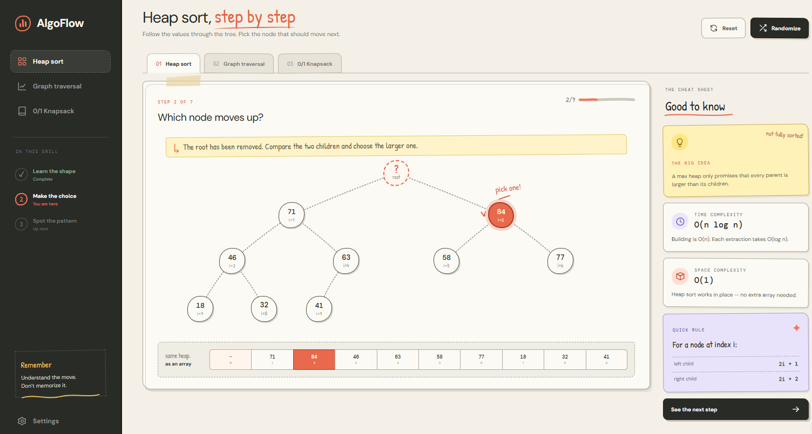
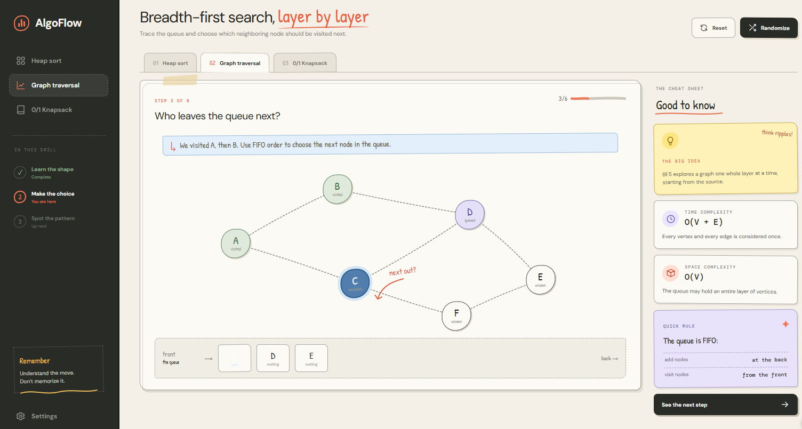
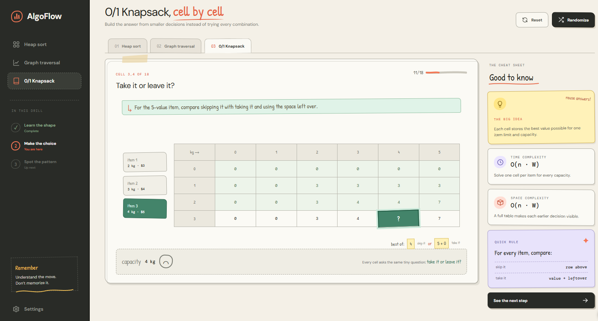

# AlgoFlow

## Overview
An interactive, web-based, study and understanding tool intended for the UGA's DSA curriculum.

Initial focus on Heap Sort, Dynamic Programming like 0/1 knapsack, and potentially graph traversal.

Heap Sort:
-Selecting Heap Sort will prompt the user for n, size of array/heap, and k, maximum range of numbers.
-After both have been entered and a button labeled create is clicked, a randomized heap matching those inputs is created.
-The user is then prompted to select the correct node in the current step, swap, and repeat until the array is sorted.
-If user makes incorrect selection, the node will flash red and one of three lives will be lost (potentially togleable for difficulty) to ensure user isn't just randomly clicking.
-Once heap is sorted, display correct animation and offer to randomize or input new parameters.
-Facts about the algorithm are displayed to the side of the working section.

Dynamic Programming:
-Similar to Heap Sort, user inputs parameters and clicks generate.
-The chart is created and the user must input and track along the algorithm.
-Similarly, mistakes result in lives lost and progress is tracked.

Graph Traversal:
-Much like heap sort as well, even can reuse node elements.
-User selects number of nodes, and values are distributed to nodes.
-Same selection process occurs.

## Order of operations
-Working and rendering UI should be prioritized.
-Then, modularized, reusable, elements built to build algorithm from inside out.
--This allows us to simply Frankenstein new algorithms together from pre-existing elements rather than reinvent the wheel everytime we want to expand.
-Then, once algorithms are working, we can focus on animation and polish.

## Team Members
| Member Name | GitHub Username |
| Luke Fisher | lwfisher |
| Ethan Esclamado | Ethan-Esclamado |
| Veer Patel | teflonhipster66 |
| Trey Buda | |
---

## Design Mock-Ups

# Heap Sort
---

# Graph Traversal
---

# Dynamic Programming
---

Running information
cd ./algoflow/
npm install
npm run dev